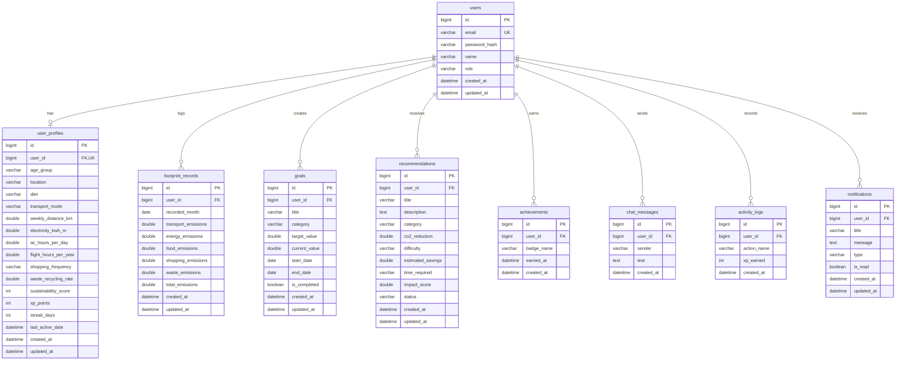

# EcoCarbon — AI-Powered Carbon Footprint Reduction Assistant

[](https://www.oracle.com/java/)
[](https://spring.io/projects/spring-boot)
[](https://react.dev/)
[](https://vitejs.dev/)
[](https://www.mysql.com/)
[](https://tailwindcss.com/)
[](https://opensource.org/licenses/MIT)

EcoCarbon is an enterprise-grade, production-ready Java Full-Stack application designed to calculate, monitor, and actively reduce personal greenhouse gas emissions. Combining localized carbon calculation, mathematical recommendation prioritization, gamified milestones, and context-aware Google Gemini AI chat, EcoCarbon turns abstract environmental metrics into practical daily reduction steps.

---

## 1. Project Overview

EcoCarbon provides users with an end-to-end platform for tracking and cutting personal carbon emissions. The application models emissions across five lifestyle categories:
- **Transportation**: Weekly commute distances, vehicle fuel types, and annual flight hours.
- **Home Energy**: Household monthly electricity consumption and daily air conditioning hours adjusted by regional electrical grid emissions.
- **Food & Diet**: Impact of dietary habits (Vegan, Vegetarian, Low Meat, High Meat).
- **Shopping & Consumer Goods**: Manufacturing and supply chain footprint for minimalists, average consumers, and frequent shoppers.
- **Waste Management**: Municipal landfill emissions offset by household recycling and composting.

---

## 2. Features

- **Personalized Eco Onboarding**: Interactive lifestyle profiling that computes initial baseline footprint and awards the *"Eco Beginner"* achievement badge.
- **Deterministic Carbon Calculation Engine**: Formula-driven, test-covered microservice calculating exact emissions with regional electrical grid factors (India, USA, Europe, China, Global default).
- **Dynamic Recommendation Engine**: Prioritizes suggestions using `Impact Score = CO2 Reduction × Feasibility × Category Weight`, automatically filtering suggestions based on user habits.
- **Goal Tracking & Milestone System**: Set category-specific reduction targets (e.g. reduce transport emissions by 25 kg CO₂) with live progress bars and automatic XP rewards upon completion.
- **Gamification & Level Progression**: Earn XP (500 XP per level), maintain consecutive daily login streaks, and unlock 6 milestone badges.
- **Context-Aware AI Assistant (EcoBot)**: Real-time sustainability advisor powered by Google Gemini (with resilient local rule-based heuristic fallback).
- **Visual Analytics Dashboard**: Responsive pie charts, 12-month historical bar trends, and real-time AI profile summaries.
- **Admin Management Panel**: Role-based access control (RBAC) allowing administrators to audit users and manage roles.
- **Dual-ID Compatibility**: DTOs seamlessly serialize both relational numeric `id` and legacy `_id` (`String.valueOf(id)`) ensuring 100% frontend zero-breakage.

---

## 3. Architecture

```text
                     INTERNET / USERS
                            │
                            ▼
               ┌────────────────────────┐
               │    Netlify Hosting     │
               │ React + Vite + Tailwind│
               └────────────┬───────────┘
                            │ HTTPS REST API
                            ▼
               ┌────────────────────────┐
               │    Render / Railway    │
               │ Spring Boot 3.3.x JAR  │
               │  Port: ${PORT:8080}    │
               └──────┬──────────┬──────┘
                      │          │
         ┌────────────▼──┐   ┌───▼─────────────────────┐
         │ MySQL 8.0+    │   │ Google Gemini AI API    │
         │ (InnoDB)      │   │ (gemini-2.5-flash) with │
         └───────────────┘   │ Rule-Based Heuristic    │
                             │ Fallback Engine         │
                             └─────────────────────────┘
```

---

## 4. Tech Stack

### Backend
- **Language**: Java 21 LTS
- **Framework**: Spring Boot 3.3.0
- **Security**: Spring Security 6 with stateless JWT Bearer Token filter (`io.jsonwebtoken:jjwt:0.11.5`) & BCrypt
- **ORM / Persistence**: Spring Data JPA & Hibernate 6.x
- **Databases**:
  - **Production**: MySQL 8.0+
  - **Local / Test**: H2 In-Memory Database (automatic zero-config fallback)
- **AI Integration**: Google Gemini 2.5 Flash via Spring REST client with heuristic fallback
- **Testing**: JUnit 5, Mockito, Spring Boot Test, Spring MockMvc
- **Health & Monitoring**: Custom Actuator endpoints (`/health`, `/actuator/health`)

### Frontend
- **Framework**: React 18.3 + Vite 5.4
- **Styling**: Tailwind CSS v4 + Glassmorphism UI
- **Routing**: React Router DOM v6
- **Charts**: Recharts (Pie & Bar charts)
- **Icons**: Lucide React
- **HTTP Client**: Axios with centralized request/response interceptors

---

## 5. Project Structure

```text
Carbon_footprint/
├── backend/
│   ├── src/
│   │   ├── main/
│   │   │   ├── java/com/ecocarbon/
│   │   │   │   ├── EcoCarbonApplication.java
│   │   │   │   ├── config/              # SecurityConfig, CorsConfig
│   │   │   │   ├── controller/          # Auth, Profile, Footprint, Goal, Recommendation, Chat, Analytics, Notification, Health
│   │   │   │   ├── service/             # Calculator, Recommendation, Gamification, Goal, Chat, Gemini, Heuristic, Analytics, Notification, Auth
│   │   │   │   ├── repository/          # Spring Data JPA repositories (9 entities)
│   │   │   │   ├── entity/              # User, UserProfile, FootprintRecord, Goal, Recommendation, Achievement, ChatMessage, ActivityLog, Notification
│   │   │   │   ├── dto/                 # Request/Response DTOs with dual-ID serialization
│   │   │   │   ├── security/            # JwtTokenProvider, JwtAuthenticationFilter, UserPrincipal, UserDetailsServiceImpl, AuthEntryPointJwt
│   │   │   │   └── exception/           # GlobalExceptionHandler, Custom exceptions, ApiErrorResponse
│   │   │   └── resources/
│   │   │       ├── application.properties
│   │   │       ├── application-dev.properties
│   │   │       └── application-prod.properties
│   │   └── test/
│   │       └── java/com/ecocarbon/      # CarbonCalculatorTest, GamificationServiceTest, RecommendationServiceTest, GoalServiceTest, AuthServiceTest, EcoCarbonIntegrationTest
│   ├── Dockerfile                       # Multi-stage production Dockerfile (Eclipse Temurin 21)
│   ├── Procfile                         # Heroku/Render/Railway start script
│   └── pom.xml                          # Maven build configuration
├── frontend/
│   ├── src/
│   │   ├── components/                  # CarbonCharts, Sidebar, Modal, LoadingSkeleton, Toast
│   │   ├── context/                     # AuthContext, CarbonContext
│   │   ├── layouts/                     # DashboardLayout
│   │   ├── pages/                       # Login, Register, Dashboard, Calculator, Recommendations, Goals, Chat, Achievements, Profile
│   │   ├── services/api.js              # Centralized Axios client with automatic Bearer token injection
│   │   ├── App.jsx
│   │   ├── index.css
│   │   └── main.jsx
│   ├── Dockerfile                       # Multi-stage Nginx build
│   ├── nginx.conf                       # SPA reverse proxy routing
│   ├── netlify.toml                     # Netlify rewrite rules
│   └── vite.config.js                   # Vite configuration with Spring Boot proxy
├── docker-compose.yml                   # Production-ready compose stack (MySQL, Spring Boot, React)
├── netlify.toml                         # Root Netlify configuration
├── render.yaml                          # Render Blueprint infrastructure as code
├── railway.json                         # Railway deployment configuration
└── README.md
```

---

## 6. Database Schema (MySQL)



---

## 7. API Documentation

| Method | Endpoint | Authorization | Description |
|---|---|---|---|
| `POST` | `/api/auth/register` | Public | Register user, calculate baseline footprint, create profile & award badge |
| `POST` | `/api/auth/login` | Public | Authenticate user, verify BCrypt password, update streak, return JWT |
| `GET` | `/api/auth/me` | Bearer JWT | Fetch user profile, badges, and account metadata |
| `POST` | `/api/auth/logout` | Bearer JWT | Logout acknowledgment |
| `GET` | `/api/auth/users` | Admin (`ROLE_ADMIN`) | List all registered user accounts |
| `PUT` | `/api/auth/users/{id}/role` | Admin (`ROLE_ADMIN`) | Update user role (`user` or `admin`) |
| `DELETE` | `/api/auth/users/{id}` | Admin (`ROLE_ADMIN`) | Delete user account and linked data |
| `GET` | `/api/profile` | Bearer JWT | Fetch current user eco profile |
| `PUT` | `/api/profile` | Bearer JWT | Update habits, re-evaluate emissions, log monthly record, emit alert |
| `GET` | `/api/footprint/history` | Bearer JWT | Fetch historical monthly carbon emissions |
| `POST` | `/api/footprint/calculate` | Bearer JWT | Ad-hoc carbon calculation with category breakdown |
| `GET` | `/api/recommendations` | Bearer JWT | Retrieve active customized recommendations pool |
| `POST` | `/api/recommendations/action` | Bearer JWT | Perform action (`completed` or `skipped`), award XP & update goals |
| `POST` | `/api/recommendations/regenerate` | Bearer JWT | Regenerate fresh recommendations pool |
| `GET` | `/api/goals` | Bearer JWT | List active and completed reduction goals |
| `POST` | `/api/goals` | Bearer JWT | Create a new target goal |
| `PUT` | `/api/goals/{id}` | Bearer JWT | Update goal progress or target |
| `DELETE` | `/api/goals/{id}` | Bearer JWT | Delete a goal |
| `GET` | `/api/chat/history` | Bearer JWT | Retrieve last 50 chat messages |
| `POST` | `/api/chat` | Bearer JWT | Send prompt to Gemini AI (with heuristic fallback) |
| `DELETE` | `/api/chat/history` | Bearer JWT | Clear user chat history |
| `GET` | `/api/analytics/summary` | Bearer JWT | Aggregate dashboard data (profile, charts, AI summary, goals) |
| `GET` | `/api/dashboard` | Bearer JWT | Alias for analytics summary |
| `GET` | `/api/notifications` | Bearer JWT | Fetch notification stream |
| `PUT` | `/api/notifications/mark-all` | Bearer JWT | Mark all notifications as read |
| `PUT` | `/api/notifications/{id}/read` | Bearer JWT | Mark single notification as read |
| `DELETE` | `/api/notifications/{id}` | Bearer JWT | Delete notification |
| `GET` | `/health` / `/actuator/health` | Public | System & database health status |

---

## 8. Carbon Calculation Engine

All emissions are calculated deterministically using standard greenhouse gas equivalencies:

### Transport Emissions
$$\text{Transport} = (\text{Weekly Commute Km} \times 4.33 \times F_{\text{transport}}) + \left(\frac{\text{Flight Hours}}{12} \times 90.0\right)$$
- **Petrol Car**: $0.18\text{ kg CO}_2/\text{km}$
- **Electric Car**: $0.05\text{ kg CO}_2/\text{km}$
- **Motorcycle**: $0.10\text{ kg CO}_2/\text{km}$
- **Public Transport**: $0.06\text{ kg CO}_2/\text{km}$
- **Walking / Cycling**: $0.00\text{ kg CO}_2/\text{km}$

### Home Energy Emissions
$$\text{Energy} = (\text{Monthly kWh} \times F_{\text{grid}}) + (\text{AC Hours/Day} \times 30 \times 1.5\text{ kW} \times F_{\text{grid}})$$
- **India**: $0.82\text{ kg CO}_2/\text{kWh}$
- **USA**: $0.38\text{ kg CO}_2/\text{kWh}$
- **Europe**: $0.25\text{ kg CO}_2/\text{kWh}$
- **China**: $0.61\text{ kg CO}_2/\text{kWh}$
- **Global Default**: $0.50\text{ kg CO}_2/\text{kWh}$

### Food & Diet Emissions
$$\text{Food} = F_{\text{diet}} \times 30$$
- **Vegan**: $1.5\text{ kg CO}_2/\text{day}$
- **Vegetarian**: $2.5\text{ kg CO}_2/\text{day}$
- **Low Meat**: $4.0\text{ kg CO}_2/\text{day}$
- **High Meat**: $7.5\text{ kg CO}_2/\text{day}$

### Shopping Emissions
- **Low / Minimalist**: $15.0\text{ kg CO}_2/\text{month}$
- **Medium / Average**: $50.0\text{ kg CO}_2/\text{month}$
- **High / Frequent**: $150.0\text{ kg CO}_2/\text{month}$

### Waste Emissions
$$\text{Waste} = \max\left(0, 15.0 \times (1 - 0.6 \times \text{Recycling Rate})\right)$$

### Sustainability Score (10–100)
$$\text{Base Score} = 100 - \frac{\text{Total Emissions}}{8}$$
- Bonus points: Vegan (+10), Vegetarian (+5), Waste Recycling > 0.5 (+5), Walk/Bicycle Commute (+5).

---

## 9. Local Development Setup

### Prerequisites
- **Java 21 LTS**
- **Maven 3.9+**
- **Node.js 18+ & npm**
- **MySQL 8.0+** (Optional: H2 in-memory is enabled by default for zero-configuration startup!)

### Option A: Running with Docker Compose (Full Stack)
```bash
docker compose up --build
```
- Frontend: `http://localhost:3000`
- Backend API: `http://localhost:8080`
- MySQL: `localhost:3306`

### Option B: Running Manually

#### 1. Backend (Spring Boot)
```bash
cd backend

# Run with in-memory H2 database (Zero setup required)
mvn clean spring-boot:run

# Or run with MySQL:
# Set environment variables:
# set DB_URL=jdbc:mysql://localhost:3306/carbon
# set DB_USERNAME=root
# set DB_PASSWORD=yourpassword
# mvn clean spring-boot:run
```
The Spring Boot backend will start at `http://localhost:8080`.
Health check: `http://localhost:8080/health`.

#### 2. Frontend (React + Vite)
```bash
cd frontend
npm install
npm run dev
```
The Vite React client will start at `http://localhost:3000` and automatically proxy all `/api` calls to Spring Boot on `localhost:8080`.

---

## 10. Environment Variables

### Backend (`backend/.env.example`)
| Variable | Default Value | Description |
|---|---|---|
| `PORT` | `8080` | Port for the Spring Boot application |
| `SPRING_PROFILES_ACTIVE` | `dev` | Profile (`dev` for H2, `prod` for MySQL) |
| `DB_URL` | `jdbc:h2:mem:ecocarbon` | MySQL JDBC connection string |
| `DB_USERNAME` | `sa` | Database username |
| `DB_PASSWORD` | *(empty)* | Database password |
| `JWT_SECRET` | *(secret key)* | 256-bit secret string for signing JWT tokens |
| `JWT_EXPIRATION` | `604800000` | Token validity duration in ms (7 days) |
| `GEMINI_API_KEY` | *(empty)* | Google Gemini API key (optional, fallback available) |
| `CORS_ALLOWED_ORIGINS` | `http://localhost:3000` | Comma-separated list of allowed CORS origins |

### Frontend (`frontend/.env.example`)
| Variable | Description |
|---|---|
| `VITE_API_BASE_URL` | Base HTTPS URL of deployed Spring Boot backend (leave empty for local dev proxy) |
| `VITE_AWS_API_GATEWAY_URL` | Optional: AWS API Gateway endpoint if testing serverless microservice |

---

## 11. Production Deployment Guide

### A. Deploy Frontend on Netlify
1. Connect your repository to Netlify.
2. Configure build settings:
   - **Base directory**: `frontend`
   - **Build command**: `npm run build`
   - **Publish directory**: `dist`
3. Add Environment Variable in Netlify:
   - `VITE_API_BASE_URL`: `https://your-spring-app.onrender.com` (or Railway URL)
4. Deploy! The included `netlify.toml` automatically handles SPA routing and asset caching.

### B. Deploy Backend on Render
1. Create a new **Web Service** on Render pointing to your repository.
2. Settings:
   - **Root Directory**: `backend`
   - **Environment**: `Java` (or `Docker`)
   - **Build Command**: `mvn clean package -DskipTests`
   - **Start Command**: `java -Dserver.port=$PORT -jar target/ecocarbon-backend-1.0.0.jar`
   - **Health Check Path**: `/health`
3. Set Environment Variables in Render:
   - `SPRING_PROFILES_ACTIVE`: `prod`
   - `DB_URL`: `jdbc:mysql://<host>:<port>/<database>?useSSL=true&allowPublicKeyRetrieval=true`
   - `DB_USERNAME`: `<username>`
   - `DB_PASSWORD`: `<password>`
   - `JWT_SECRET`: `<secure-random-256-bit-key>`
   - `GEMINI_API_KEY`: `<your-gemini-key>`
   - `CORS_ALLOWED_ORIGINS`: `https://your-app.netlify.app`

### C. Deploy Backend on Railway
1. Create a new Project on Railway.
2. Add a **MySQL** database from Railway marketplace. Copy the connection credentials.
3. Deploy the Spring Boot application from GitHub.
4. Set Railway Environment Variables:
   - `SPRING_PROFILES_ACTIVE`: `prod`
   - `DB_URL`: `jdbc:mysql://${{MYSQLHOST}}:${{MYSQLPORT}}/${{MYSQLDATABASE}}?useSSL=false&allowPublicKeyRetrieval=true`
   - `DB_USERNAME`: `${{MYSQLUSER}}`
   - `DB_PASSWORD`: `${{MYSQLPASSWORD}}`
   - `JWT_SECRET`: `<secure-random-256-bit-key>`
   - `GEMINI_API_KEY`: `<your-gemini-key>`
   - `CORS_ALLOWED_ORIGINS`: `https://your-app.netlify.app`
5. Railway will build the JAR using `NIXPACKS` and run the health check at `/health`.

---

## 12. Testing

The backend includes a comprehensive JUnit 5 and Mockito test suite covering calculation mathematics, gamification logic, recommendation filtering, and end-to-end integration flows.

Run all tests:
```bash
cd backend
mvn test
```

### Test Suite Summary:
- `AuthServiceTest`: Registration, duplicate email check, invalid credential rejection, valid login token generation.
- `CarbonCalculatorTest`: Transport, Energy, Food, Shopping, Waste, Grid factors, recycling boundaries.
- `GamificationServiceTest`: Level thresholds ($500\text{ XP} = 1\text{ level}$), XP award logging, milestone badge unlocks.
- `RecommendationServiceTest`: Impact scoring, difficulty multipliers, and vegan profile filtering.
- `GoalServiceTest`: Goal creation, progress updates, completion detection, unauthorized access rejection.
- `EcoCarbonIntegrationTest`: MockMvc end-to-end integration testing authentication, protected routes, calculations, and AI chat fallback.

---

## 13. Security Hardening Audit

- **Zero Hardcoded Secrets**: Secrets and database passwords are injected strictly via environment variables.
- **BCrypt Password Hashing**: Passwords hashed using standard salt rounds; password hashes are excluded from all DTO responses.
- **JWT Authorization**: Requests authenticated through standard `Authorization: Bearer <token>` headers; invalid/expired tokens return HTTP 401.
- **SQL Injection Prevention**: Hibernate ORM parameter binding and typed JPQL queries eliminate SQL injection vulnerabilities.
- **CORS Hardening**: Strict origin whitelist configured via `SecurityConfig`; wildcard `*` with credentials is explicitly prohibited.
- **Resilient AI Fallback**: If the Gemini API fails or is unconfigured, the app falls back to rule-based heuristics rather than failing or exposing stack traces.

---

## 14. Cloud-Agnostic Production Architecture

EcoCarbon is 100% self-contained and cloud-agnostic:
- **Zero Proprietary Cloud Lock-in**: Runs directly via Docker Compose, on standard Linux VMs, or on modern developer clouds (Render, Railway, Netlify) without requiring AWS accounts, API Gateway, DynamoDB, or Lambda.
- **Portability**: All data storage is standardized on MySQL 8.0 / JPA Hibernate, with full environment variable configurability (`DB_URL`, `DB_USERNAME`, `DB_PASSWORD`, `JWT_SECRET`, `GEMINI_API_KEY`).

---

## 15. License

This project is licensed under the MIT License — see the [LICENSE](LICENSE) file for details.
